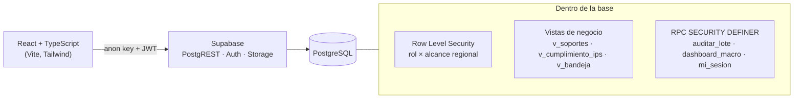

# RedDoc 360

**Gestión documental para una red de IPS aliadas**: portal de cargue para las sedes, bandeja de auditoría, tableros de cumplimiento y control de acceso por rol y por regional, con toda la seguridad aplicada dentro de PostgreSQL.

> Es la reconstrucción, sobre Supabase, de un sistema que diseñé y operé en Google Apps Script con Google Sheets como base de datos. Se conservan la lógica de negocio, los roles y los permisos. Los datos de este repositorio son **100 % ficticios** y se generan con un script determinista.

  

---

## El problema

Una red de salud ocupacional trabaja con decenas de IPS aliadas en varias regionales. Cada sede debe mantener al día unos 40 soportes (habilitación, licencias, pólizas, mantenimiento y calibración de cada equipo…), y cada uno vence en una fecha distinta. La red necesita saber en todo momento **qué está vigente, qué está por vencer y qué falta**, sin que ninguna sede vea la información de otra.

## Qué hace

| # | Módulo | Quién lo usa |
|---|---|---|
| 1 | **Portal de la IPS**: carga, actualización e inactivación de soportes, por lotes | La sede (escritura); los perfiles internos lo consultan en solo lectura |
| 2 | **Panel de auditoría**: aprobación y rechazo por lotes, con traza inmutable | Auditores |
| 3 | **Dashboard ejecutivo**: KPIs, alertas y cumplimiento por regional | Dirección de red |
| 4 | **Dashboard por documento**: estado de un requisito en toda la red | Dirección de red |
| 5 | **Panel comercial**: vitrina pública de soportes aprobados y vigentes | Público (la IPS aliada queda vetada) |
| 6 | **Panel de vinculación**: contrato, datos bancarios, SARLAFT | Solo la dirección de red |
| 7 | **Licencias médicas**: seguimiento de vencimientos | Auditores y dirección |

## Arquitectura



**La base de datos es la frontera de seguridad.** El frontend nunca decide qué datos puede ver un usuario:

- **Lectura → RLS.** Cada fila se filtra por dos ejes independientes: el **rol** (qué módulos) y el **alcance regional** (sobre qué IPS). Un auditor de «Remotas» consulta la misma tabla que el administrador universal y solo recibe sus sedes. Un auditor sin regionales asignadas no recibe nada.
- **Escritura → solo por RPC.** Ningún rol puede hacer `UPDATE` ni `DELETE` directos. Las decisiones pasan por funciones que validan rol, alcance, transición de estado y reglas del requisito.
- **Vetos que ganan siempre.** La vitrina comercial es de acceso libre, pero la IPS aliada la tiene vetada: el veto se evalúa antes que la autorización, igual que en el sistema original.

### Reglas de negocio destacadas (en SQL)

- **Qué soporte representa a un requisito** (`v_soportes`). En un requisito de un solo soporte gana el de vencimiento más lejano, no el último cargado. En uno de varias unidades (22 básculas de una sede) manda la **peor** unidad, con el conteo «Vencido · 3 de 22». Un soporte en auditoría no tapa uno vencido, y un requisito marcado inactivo sale del cálculo.
- **Cumplimiento** (`v_cumplimiento_ips`). Se mide sobre lo *exigido* según la matriz de aplicabilidad, no sobre lo cargado. Un requisito inactivo sale del numerador **y** del denominador.
- **Auditoría por lotes** (`auditar_lote`). Cada decisión se valida por separado y una inválida no tumba el lote. Rechazar exige motivo y purga el soporte, pero la traza sobrevive. Aprobar sin fecha asigna la vigencia por defecto. La licencia de médicos especialistas exige los datos del médico. Se envía un solo aviso por sede, no uno por documento.

## Modelo de datos

`regionales` · `ips` · `documentos` (catálogo de requisitos) · `matriz` (aplicabilidad requisito × IPS) · `cargues` (cada soporte y su estado) · `auditoria_estados` (traza inmutable) · `modificaciones` · `notificaciones` · `perfiles` (roles y regionales) · `parametros`.

Cada tabla corresponde a una pestaña del libro de Sheets original. Las columnas que en Sheets había que escribir a mano (llaves compuestas, estado calculado) aquí son vistas.

## Pruebas

```bash
npm test
```

Las **44 pruebas** corren contra un **PostgreSQL real embebido** ([PGlite](https://pglite.dev), WebAssembly), con las mismas migraciones y el mismo seed que producción. No hace falta Docker. Cubren:

- la RLS: cada rol ve exactamente su alcance, y el anónimo no ve nada sensible;
- los casos borde de la consolidación de soportes;
- las validaciones de la auditoría por lotes, incluidos los intentos fuera del alcance regional;
- el espejo en TypeScript de las reglas que usa la interfaz.

## Ejecutar en local

```bash
npm install
npm test                 # pruebas de dominio y de base de datos
npm run dev              # http://localhost:5173
```

Para conectar un proyecto de Supabase:

1. Copie `.env.example` como `.env` y complete la URL y las claves.
2. Aplique `supabase/migrations/*.sql` y luego `supabase/seed.sql` desde el SQL editor o con el CLI de Supabase.
3. Ejecute `npm run usuarios:demo` para crear los usuarios de demostración (uno por rol y uno por regional).

`npm run seed:generar` regenera los datos ficticios: 42 IPS, 37 requisitos, unos 1.900 cargues. Las fechas son relativas al día de carga, así que el tablero siempre se ve actual.

## Estructura

```
supabase/migrations/   esquema, lógica (vistas y RPC) y seguridad (RLS, Storage)
supabase/seed.sql      datos ficticios generados
scripts/               generador del seed y creación de usuarios demo
src/domain/            reglas de acceso y vigencia en TypeScript (con pruebas)
test/db/               pruebas de base de datos sobre PGlite
```

## Hoja de ruta

- [x] Esquema, lógica de negocio y seguridad en PostgreSQL
- [x] Datos ficticios deterministas y pruebas de base de datos
- [ ] Interfaz de los 7 módulos
- [ ] Acceso de la IPS con su identificador (Edge Function)
- [ ] Carga de archivos a Supabase Storage y visor de soportes
- [ ] Despliegue público de la demo

## Stack

PostgreSQL · Supabase (Auth, PostgREST, Storage, RLS) · React 19 · TypeScript · Vite · Tailwind CSS · Vitest · PGlite

## Licencia

MIT © 2026 Nicolás Santa
