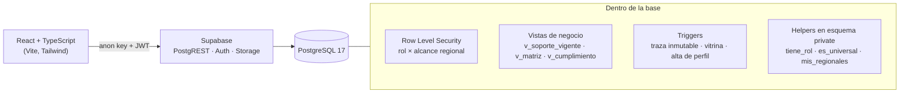

# RedDoc 360

**Gestión documental para una red de IPS aliadas**: portal de cargue para las sedes, bandeja de auditoría, tableros de cumplimiento y control de acceso por rol y por regional, con toda la seguridad aplicada dentro de PostgreSQL.

> Es la reconstrucción, sobre Supabase, de un sistema que diseñé y operé en Google Apps Script con Google Sheets como base de datos. Se conservan la lógica de negocio, los roles y los permisos. Los datos de este repositorio son **100 % ficticios**; el proyecto no contiene información de ninguna organización real.

  

---

## El problema

Una red de salud ocupacional trabaja con decenas de IPS aliadas en varias regionales. Cada sede debe mantener al día unos 40 soportes (habilitación, licencias, pólizas, mantenimiento y calibración de cada equipo…), y cada uno vence en una fecha distinta. La red necesita saber en todo momento **qué está vigente, qué está por vencer y qué falta**, sin que ninguna sede vea la información de otra.

## Qué hace

| # | Módulo | Quién lo usa |
|---|---|---|
| 1 | **Portal de la IPS**: carga e inactivación de soportes | La sede (escritura); los perfiles internos lo consultan en solo lectura |
| 2 | **Panel de auditoría**: aprobación y rechazo, con traza inmutable | Auditores |
| 3 | **Dashboard ejecutivo**: KPIs, alertas y cumplimiento por regional | Dirección de red |
| 4 | **Dashboard por documento**: estado de un requisito en toda la red | Dirección de red |
| 5 | **Panel comercial**: vitrina pública de soportes aprobados y vigentes | Público (la IPS aliada queda vetada) |
| 6 | **Panel de vinculación**: contrato, datos bancarios, SARLAFT | Solo la dirección de red |
| 7 | **Licencias médicas**: seguimiento de vencimientos | Auditores y dirección |

## Arquitectura



**La base de datos es la frontera de seguridad.** El frontend nunca decide qué datos puede ver o tocar un usuario:

- **Lectura → RLS.** Cada fila se filtra por dos ejes independientes: el **rol** (qué módulos) y el **alcance regional** (sobre qué IPS). Un auditor de «Remotas» consulta la misma tabla que el administrador universal y solo recibe sus sedes; un auditor sin regionales asignadas no recibe nada. El alcance lo resuelven helpers `SECURITY DEFINER` que viven en un esquema `private`, fuera de la API pública.
- **Escritura → RLS por operación.** Las políticas de `INSERT`/`UPDATE`/`DELETE` acotan cada acción: un **PROVEEDOR** solo puede insertar soportes de *su* IPS y en estado `Pendiente`; solo **AUDITOR**/**ADMINISTRADOR** actualizan, y únicamente dentro de sus regionales. Nadie escribe fuera de lo que su rol permite.
- **Traza que no depende de la app.** Un trigger (`registrar_cambio_estado`) escribe la fila de auditoría en cada cambio de estado de un soporte: la evidencia se genera en la base, no en el cliente.
- **Vetos y confidencialidad en la base.** La vitrina pública solo admite documentos clasificados como `Externa`: un trigger (`validar_bucket`) lo verifica antes de aceptar un archivo en el bucket público.

### Reglas de negocio destacadas (en SQL)

- **Qué soporte representa a un requisito** (`v_soporte_vigente`). Descarta históricos, duplicados e inactivos y elige uno por par (IPS, documento): en un requisito de varias unidades (las 22 básculas de una sede) manda la **peor** por vigencia (`peso_vigencia`); en el resto, el de vencimiento más lejano y cargue más reciente.
- **Vigencia parametrizada** (`vigencia()`). Traduce estado de auditoría + fecha de vencimiento a `Vigente / Próximo a Vencer / Vencido / Pendiente / Inactivo`, con la ventana amarilla leída de la tabla `parametros` (`DIAS_ALERTA_AMARILLA`), no incrustada en el código.
- **Cumplimiento** (`v_cumplimiento`). Se mide sobre lo *exigido* según la matriz de aplicabilidad, no sobre lo cargado. Un requisito inactivo sale del numerador **y** del denominador.

## Modelo de datos

Tablas: `regionales` · `ips` · `documentos` (catálogo de requisitos) · `perfiles` (PK = `auth.users.id`, roles como `rol_usuario[]`) · `perfil_regionales` (alcance regional) · `soportes` (cada soporte y su estado) · `requisitos_inactivos` · `auditoria_estados` (traza inmutable) · `modificaciones` · `notificaciones` · `parametros`.

Vistas: `v_soportes` · `v_soporte_vigente` · `v_matriz` (requisito × IPS con su estado) · `v_cumplimiento`.

Tipos de dominio como **enums** de PostgreSQL: `rol_usuario`, `estado_auditoria`, `estado_vigencia`, `categoria_documento`, `clasificacion`, `tipo_notificacion`, `accion_modificacion`. Cada tabla corresponde a una pestaña del libro de Sheets original; lo que allí se escribía a mano (estado calculado, aplicabilidad) aquí son vistas y funciones.

## Cómo se construye la base

Las migraciones en `supabase/migrations/` reproducen la base entera, en orden, desde cero:

| Archivo | Contenido |
|---|---|
| `…0001_baseline.sql` | Enums, 11 tablas, funciones, 4 vistas, triggers y RLS con sus 17 políticas |
| `…0002_seguridad_helpers.sql` | Mueve los helpers de sesión a un esquema `private` (fuera de la API REST) y recablea las políticas |

```bash
# con el CLI de Supabase, contra un proyecto propio
supabase db push
# o pegando cada archivo, en orden, en el SQL Editor
```

## Ejecutar el frontend en local

```bash
npm install
npm test        # pruebas del dominio en TypeScript (roles, alcance, vigencia)
npm run dev     # http://localhost:5173
```

Para conectar un proyecto de Supabase, copie `.env.example` como `.env`, complete la URL y las claves, y aplique las migraciones. (La carga de datos y usuarios de demostración del nuevo modelo está en la hoja de ruta.)

## Estructura

```
supabase/migrations/   la base entera, reproducible y versionada
src/domain/            reglas de acceso y vigencia en TypeScript (con pruebas)
src/                   app React (Vite + Tailwind)
```

## Hoja de ruta

- [x] **Fundación de la base**: esquema, lógica (vistas y triggers) y seguridad (RLS) en PostgreSQL, versionada como migraciones
- [ ] Datos ficticios de demostración para el nuevo modelo
- [ ] Pruebas de base de datos (RLS y reglas) sobre el esquema real, con PGlite
- [ ] Interfaz de los 7 módulos conectada a Supabase
- [ ] Carga de archivos a Supabase Storage y visor de soportes
- [ ] Despliegue público de la demo

## Stack

PostgreSQL 17 · Supabase (Auth, PostgREST, Storage, RLS) · React 19 · TypeScript · Vite · Tailwind CSS · Vitest

## Licencia

MIT © 2026 Nicolás Santa
